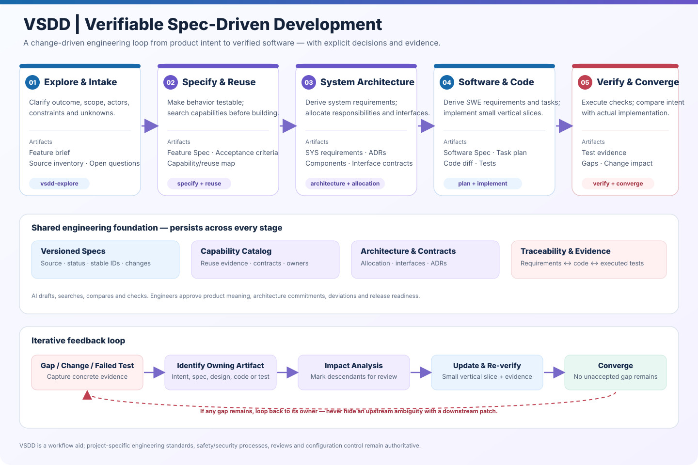

# VSDD — Verifiable Spec-Driven Development

**A change-driven, evidence-backed workflow from product intent to verified software.**

[中文版（Chinese guide）](README.zh-CN.md) · [Architecture & workflow diagram](docs/assets/vsdd-architecture-workflow.svg)



VSDD combines reusable Agent Skills, versioned engineering artifacts, explicit human approval gates, traceability contracts, and a dependency-free CLI. It is designed for mixed AI coding environments and includes an automotive-software example.

> Core rule: no AI-generated assumption silently becomes a requirement, design decision, implementation behavior, or pass result.

## Install once, use in every project

Requirements: Bash on Linux/macOS/WSL and Python 3.10+. No third-party Python dependencies.

```bash
git clone https://github.com/xcai8698/vsdd.git
cd vsdd
bash install.sh
```

The installer places the global command in `~/.local/bin/vsdd` and runtime assets in `~/.local/share/vsdd`. If the installer says PATH is not updated, run:

```bash
export PATH="$HOME/.local/bin:$PATH"
```

Then verify:

```bash
vsdd --version
vsdd --help
```

For a custom install prefix, run `bash install.sh "$HOME/tools"` and add `$HOME/tools/bin` to PATH.

## Initialize any project

From your target repository:

```bash
cd /path/to/your-project
vsdd init
# or explicitly:
vsdd init --root /path/to/your-project
```

`init` recursively syncs all packaged files under `.agents/`, including every VSDD Skill; copies missing VSDD templates; and creates the default constitution/config only if they do not already exist. Project-specific Skills and existing configuration are preserved. Existing project templates are preserved by default. To deliberately refresh them from the installed kit, use `vsdd init --update-templates` after reviewing local customizations.

## Quick start: create a change

```bash
vsdd new add-speed-warning
vsdd status
vsdd validate add-speed-warning
vsdd trace add-speed-warning --id FR-001
```

Each change gets a directory under `.vsdd/changes/<change-id>/` with the feature brief, capability map, Feature Spec, system requirements, architecture, software requirements, tasks, traceability, verification and change records.

Open the project in an AI coding environment that supports Agent Skills and ask it to follow `.agents/skills/vsdd-orchestrate/SKILL.md`. The Orchestrator uses stage-specific Skills and keeps requirements, implementation and evidence linked.

## Workflow

1. **Explore** — clarify outcome, scope, actors, constraints, baseline behavior and unknowns.
2. **Capability map** — inspect existing specs, interfaces, code and tests; decide reuse / extend / create / reject with evidence.
3. **Specify** — produce observable scenarios and acceptance criteria without inventing missing product behavior.
4. **System architecture** — derive system requirements, responsibilities, interfaces, constraints and decision records.
5. **Plan** — derive software requirements and small, traceable implementation tasks.
6. **Implement** — inspect actual repository conventions and implement one vertical slice at a time.
7. **Verify** — execute tests and checks; record commands, environment, actual results and evidence.
8. **Converge** — compare approved intent with code and evidence, route gaps to the owning artifact and loop.
9. **Sync & archive** — promote only approved, converged specifications and preserve the change snapshot.

A feature is not complete because code compiles, tasks are checked, or tests were authored. Completion requires approved acceptance criteria, applicable executed evidence, and dispositioned residual gaps.

## Stage commands

```bash
vsdd advance add-speed-warning --to capability-mapped --approval REVIEW-123
vsdd advance add-speed-warning --to specified --approval REVIEW-124
vsdd sync add-speed-warning --approval BASELINE-REVIEW-123
vsdd archive add-speed-warning
```

Approval arguments are references to actual records. The CLI stores the reference; it does not authenticate the reviewer or replace a formal review. Stages cannot be skipped. Existing baselines are not overwritten unless `--overwrite` is explicitly requested; prior files are backed up under `.vsdd/specs/history/`.

## Skills

| Skill | Responsibility |
|---|---|
| `vsdd-orchestrate` | Coordinate stages, gates, handoffs and feedback |
| `vsdd-explore` | Clarify intent, scope, constraints and unknowns |
| `vsdd-capabilities` | Discover and assess reusable capabilities |
| `vsdd-specify` | Author reviewable Feature Specs and acceptance criteria |
| `vsdd-architecture` | Derive system requirements, architecture and allocation |
| `vsdd-plan` | Derive software requirements, tasks and test mappings |
| `vsdd-implement` | Implement traceable vertical slices |
| `vsdd-verify` | Execute verification and collect evidence |
| `vsdd-converge` | Compare spec, code and evidence; route gaps |
| `vsdd-change` | Assess change impact and invalidate stale evidence |

The Skill source files are Markdown under `.agents/skills/`. The `init` command recursively syncs all packaged Skills into the target project's `.agents/` directory.

## Repository layout

- `.agents/skills/` — portable Agent Skills.
- `.vsdd/constitution.md` — project engineering rules and agent boundaries.
- `.vsdd/templates/` — artifact templates.
- `.vsdd/changes/<change-id>/` — active delta artifacts and evidence.
- `.vsdd/specs/` — accepted baseline specifications.
- `scripts/vsdd.py` — local/global CLI implementation.
- `docs/assets/` — architecture/workflow diagrams.
- `examples/automotive-speed-warning/` — automotive Feature-to-verification example.
- `tests/` and `.github/workflows/ci.yml` — smoke tests and CI configuration.

## Design principles

- Source-grounded, not guess-driven; assumptions and open questions are explicit.
- Stable identifiers and bidirectional traceability across requirements, architecture, code and tests.
- Human authority at semantic gates; AI drafts, searches, compares and verifies.
- Evidence over status; only executed results count as verification evidence.
- Change-aware iteration; impacted descendants and stale evidence are reviewed.
- Tool-neutral core; Skills are Markdown and the CLI uses Python's standard library.

## Automotive boundary

This kit is a workflow aid, not a functional-safety or cybersecurity certification tool. Project-specific standards, safety analyses, architecture authority, reviews, coding requirements, test policy and configuration management remain authoritative. The example explicitly leaves unspecified thresholds, timing, priorities, interfaces and failure behavior unresolved.

## Inspiration

VSDD borrows specification clarification, planning, task sequencing and analysis ideas from [GitHub Spec Kit](https://github.com/github/spec-kit), and change-scoped artifacts, iterative revision, baseline synchronization and archiving ideas from [OpenSpec](https://github.com/Fission-AI/OpenSpec). VSDD is an independent workflow implementation, not an official distribution of either project.

## License

MIT. See [LICENSE](LICENSE).
