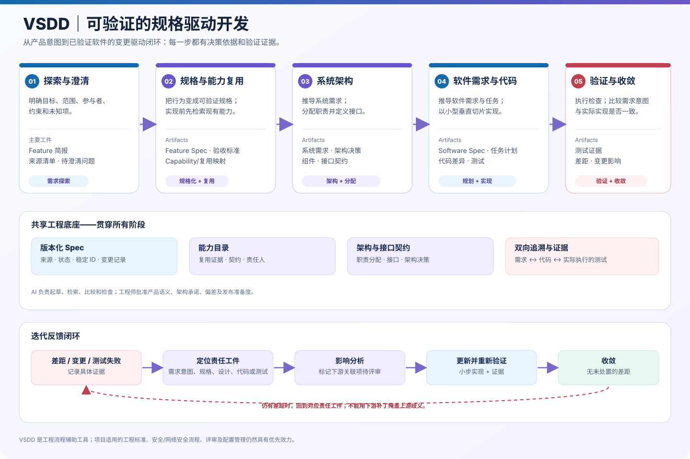

# VSDD｜可验证的规格驱动开发

**让汽车软件从产品意图到代码实现与验证，形成可执行、可追溯、可迭代的工程闭环。**

[English README](README.md) · [架构与工作流程图](docs/assets/vsdd-architecture-workflow.zh-CN.svg)



## 1. VSDD 是什么？

VSDD 不只是提示词集合，而是一套可在仓库中运行的工程机制：

- **Skills**：指导 AI 分阶段处理需求探索、能力复用、规格、架构、软件计划、实现、验证和收敛。
- **规格工件**：使用稳定 ID 管理 Feature、Capability、系统需求、软件需求、架构决策、任务和验证证据。
- **质量门禁**：缺少必需工件、仍有占位内容、未满足审批或缺少验证证据时，阻止流程推进。
- **追溯与变更管理**：将需求、架构、代码和测试关联起来；上游变化时识别下游影响并重新验证。
- **本机全局 CLI**：安装一次后，可从任意项目目录运行 `vsdd init`、`vsdd new`、`vsdd validate` 等命令。

> 核心原则：AI 生成的假设不能悄悄变成正式需求、架构决策、代码行为或测试通过结论。

## 2. 安装一次，在所有项目中使用

要求：Linux、macOS 或 WSL 的 Bash 环境；Python 3.10+。不需要第三方 Python 包。

先克隆仓库并执行安装脚本：

```bash
git clone https://github.com/xcai8698/vsdd.git
cd vsdd
bash install.sh
```

安装器默认把命令放到 `~/.local/bin/vsdd`，运行资源放到 `~/.local/share/vsdd`。如果提示 PATH 尚未更新，可运行：

```bash
export PATH="$HOME/.local/bin:$PATH"
```

也可以把 PATH 设置加入 `~/.bashrc`，然后执行 `source ~/.bashrc`。

验证全局命令：

```bash
vsdd --version
vsdd --help
```

如果需要安装到自定义前缀：

```bash
bash install.sh "$HOME/tools"
export PATH="$HOME/tools/bin:$PATH"
```

## 3. 在某个软件项目中初始化

进入项目目录后运行：

```bash
cd /path/to/your-project
vsdd init
```

也可以明确指定路径：

```bash
vsdd init --root /path/to/your-project
```

### init 会做什么？

1. **递归同步安装包中整个 `.agents/` 目录**，包括所有 VSDD Skills，而不是只创建空的 `.agents/skills` 目录。
2. 将 VSDD 模板补充到项目的 `.vsdd/templates/`。
3. 如果项目还没有 `.vsdd/constitution.md` 与 `.vsdd/config.json`，则从安装包复制默认版本。
4. 保留项目中其他无关的自定义 Skills 和已存在的配置文件。

默认情况下，项目中已经存在的模板不会被覆盖。审核后希望更新为安装包中的模板时，可执行：

```bash
vsdd init --update-templates
```

这将同步更新模板文件；请先检查本项目是否对模板做过定制。

## 4. 最基本的工作流

### 创建一个变更

```bash
vsdd new speed-warning
```

会在当前项目中创建：

```text
.vsdd/changes/speed-warning/
├── feature-brief.md
├── capability-map.md
├── feature-spec.md
├── system-requirements.md
├── architecture.md
├── software-requirements.md
├── tasks.md
├── traceability.csv
├── verification.md
├── change-record.md
├── adr.md
└── state.json
```

### 让 AI 按 VSDD 流程执行

在支持 Agent Skills 的编码工具中，要求 AI 遵循：

`.agents/skills/vsdd-orchestrate/SKILL.md`

Orchestrator 会调用各阶段的 Skill，并指导 AI 按“探索 → 能力复用 → Feature Spec → 系统需求/架构 → 软件需求/任务 → 实现 → 验证 → 收敛”的顺序推进。Skill 可以帮助 AI 工作，但不替代人工审批与项目正式流程。

### 查看状态、校验和追溯

```bash
vsdd status
vsdd validate speed-warning
vsdd trace speed-warning --id FR-001
```

### 按门禁逐阶段推进

```bash
vsdd advance speed-warning --to capability-mapped --approval REVIEW-123
```

审批引用必须指向真实评审/决策记录。该命令只记录引用，不会验证审批人身份，也不代表命令本身完成了评审。

### 同步已批准的规格并归档

```bash
vsdd sync speed-warning --approval BASELINE-REVIEW-123
vsdd archive speed-warning
```

只有实际完成收敛并记录审批后才允许同步和归档。覆盖已有基线时，必须先审查差异，并使用显式的 `--overwrite` 参数；旧版本会备份到 `.vsdd/specs/history/`。

## 5. Skills 一览

| Skill | 主要职责 |
|---|---|
| `vsdd-orchestrate` | 协调整个工作流，执行门禁并路由反馈 |
| `vsdd-explore` | 澄清产品意图、范围、约束和未知项 |
| `vsdd-capabilities` | 检索已有能力并评估复用、扩展或新建 |
| `vsdd-specify` | 生成可审查、可测试的 Feature Spec |
| `vsdd-architecture` | 推导系统需求、架构、接口与职责分配 |
| `vsdd-plan` | 派生软件需求、任务、代码定位和测试映射 |
| `vsdd-implement` | 按可追溯的垂直切片实现与更新测试 |
| `vsdd-verify` | 执行验证并收集需求级证据 |
| `vsdd-converge` | 比较规格、代码与证据，识别残余差距 |
| `vsdd-change` | 评估变更影响并使过时证据失效 |

Skills 位于 `.agents/skills/`，采用可阅读的 `SKILL.md` 文件格式。初始化时会递归同步安装包中的所有 Skills。

## 6. 工程架构与迭代闭环

完整工作流的重点是让工件之间的关系持续有效：

```text
客户输入 / Feature
  → Feature Spec + 验收场景
  → Capability 复用判断
  → 系统需求 + 系统架构 / 接口
  → 软件需求 + 实现任务
  → 代码 + 实际执行的测试
  → 验证证据 + 收敛检查
  → 已批准的基线同步与归档
```

如果测试失败、代码与规格不符或上游需求变化，应定位拥有该语义的工件，分析下游影响，更新必要工件和测试，再重新验证。不要仅在下游打补丁来掩盖上游歧义。

## 7. 汽车软件示例

`examples/automotive-speed-warning/` 包含从 Feature 到系统需求、架构、软件需求、任务、追溯关系和验证报告的示例。它用于展示流程，不是生产项目需求。未提供的阈值、时序、信号有效性、优先级、接口和失效行为仍明确标记为待澄清。

## 8. 常用目录

- `.agents/skills/`：AI 工作流 Skills。
- `.vsdd/constitution.md`：项目工程规则与 AI 不得越过的边界。
- `.vsdd/templates/`：工件模板。
- `.vsdd/changes/<change-id>/`：正在进行的变更及其增量工件。
- `.vsdd/changes/archive/`：已完成变更的归档。
- `.vsdd/specs/`：已批准的规格基线。
- `scripts/vsdd.py`：本机 CLI 实现。
- `docs/`：工作流、工件契约和门禁说明。

## 9. 工程原则

1. **先检索，再推导。** 需求、架构、接口和代码结论必须有来源。
2. **未知项不脑补。** 假设与待澄清问题必须显式管理。
3. **小步垂直切片。** 每次变更尽可能贯穿需求、代码和测试。
4. **双向追溯。** 从需求可追到实现与验证，也能从代码变化定位上游意图。
5. **证据优先于状态。** 勾选任务或创建测试不代表验证通过。
6. **人工责任不转移。** AI 可分析和提出方案；产品语义、架构取舍、豁免和发布决策由授权人员负责。
7. **基线受控。** 只同步已批准、已收敛的规格。
8. **不替代汽车工程合规。** VSDD 是工作流辅助，不替代项目适用的功能安全、网络安全、质量、评审和配置管理流程。

## 参考项目

VSDD 借鉴 [GitHub Spec Kit](https://github.com/github/spec-kit) 的规格澄清、规划、任务分解与一致性检查思路，以及 [OpenSpec](https://github.com/Fission-AI/OpenSpec) 的变更工件、可迭代修订、规格同步和归档方式。VSDD 是独立工作流工具，并非上述项目的官方发行版。

## License

MIT，详见 [LICENSE](LICENSE)。
